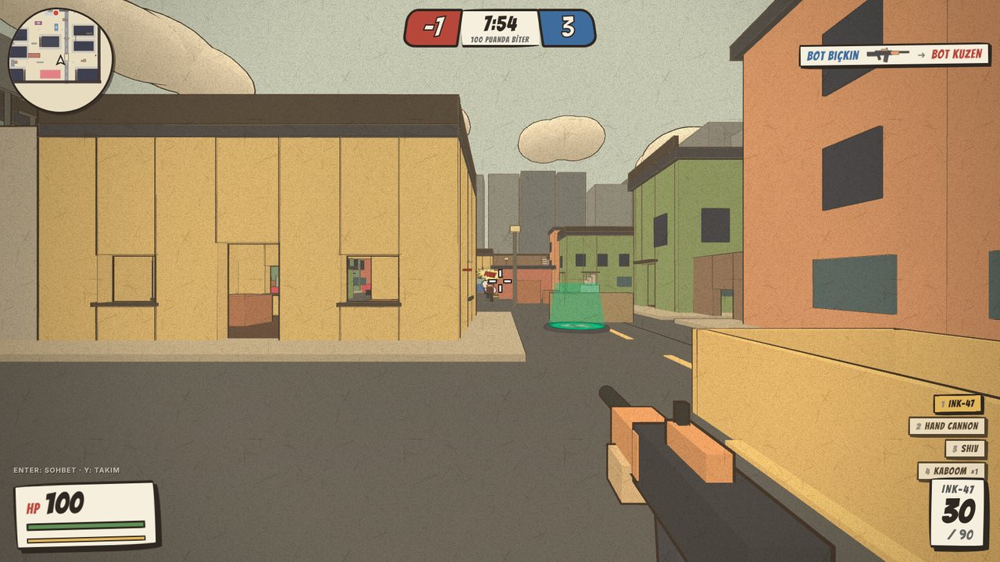
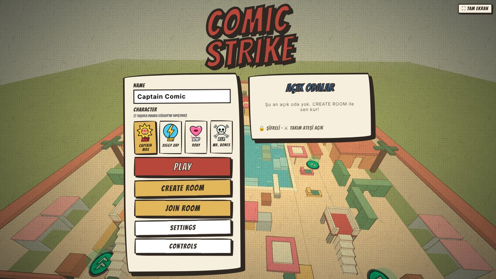
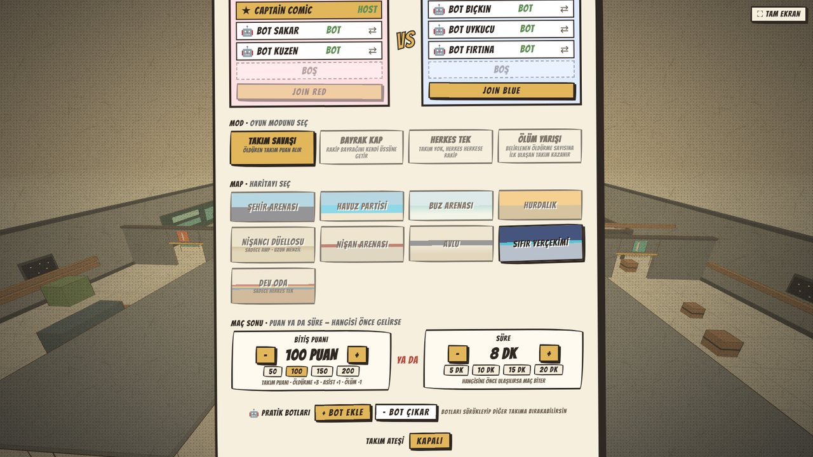
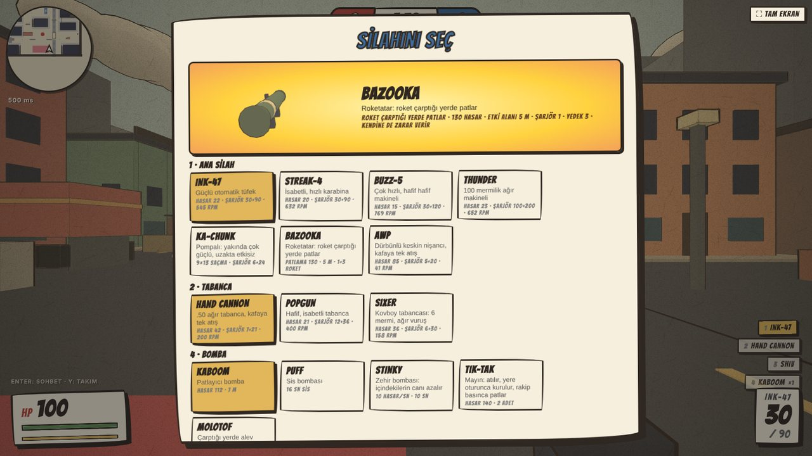
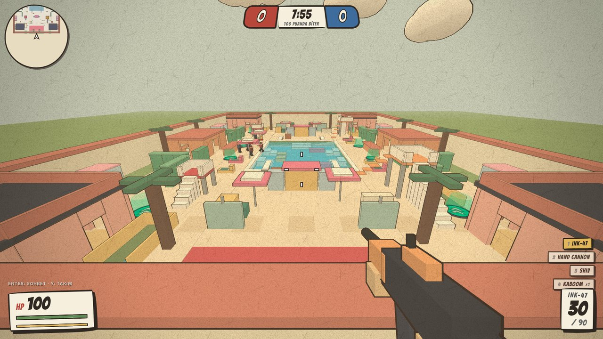
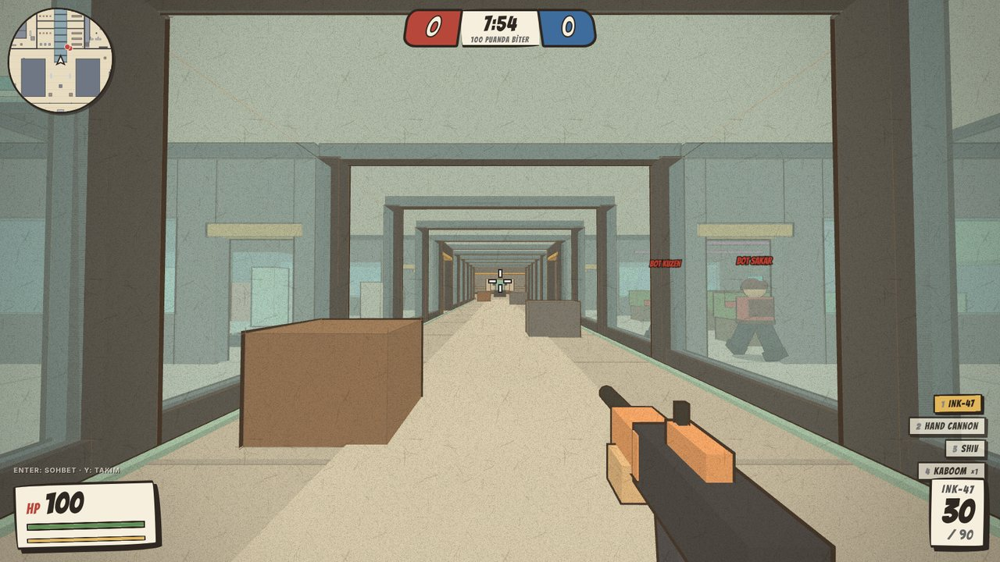
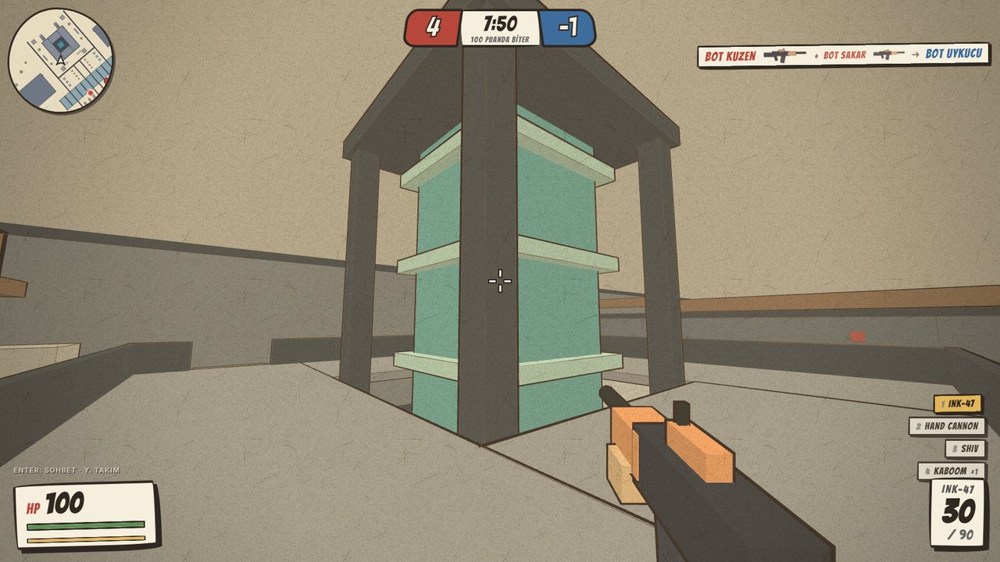
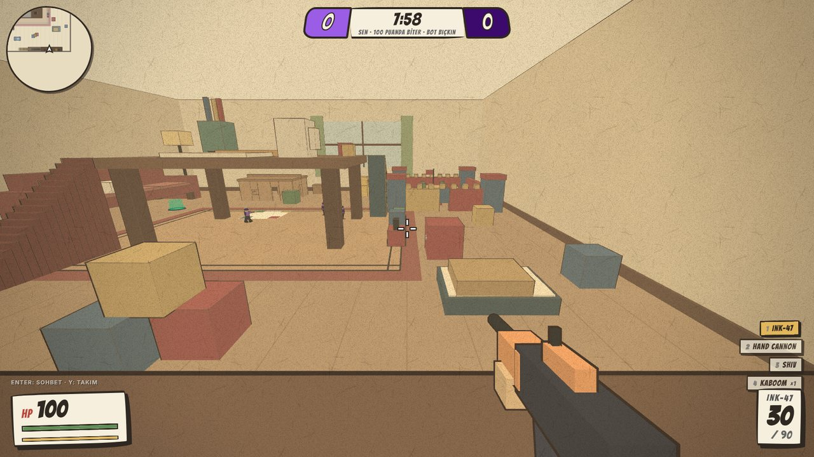

# COMIC STRIKE WEB

Tarayıcıda oynanan, çizgi roman görünümlü multiplayer FPS. Takım Savaşı, Bayrak Kap, Herkes Tek ve Ölüm Yarışı modları; 9 harita, 15 silah ve bomba, pratik botları, oda kodu ile lobi, sunucu doğrulamalı hasar ve skor.



## Oyna

https://comic-strike.onrender.com/

Linke tıkla, tarayıcıdan oyuna gir. Kurulum gerekmez.

Sunucu bir süre kullanılmazsa uyku moduna geçebilir. İlk açılışta sayfa yüklenirken biraz bekleyebilirsin (yaklaşık 30-50 saniye).

Sunucunun ayakta olup olmadığını şuradan görebilirsin: https://comic-strike.onrender.com/api/health

## Ekran görüntüleri

| | |
| :---: | :---: |
|  |  |
| **Ana menü:** isim, karakter, açık odalar | **Lobi:** takımlar, mod, harita, maç sonu sınırları, botlar |
|  |  |
| **Silah seçimi:** dönen 3B önizleme ve değerler | **Havuz Partisi** |
|  |  |
| **Sıfır Yerçekimi:** cam koridor | **Sıfır Yerçekimi:** B bölgesi, reaktör odası |
|  | |
| **Dev Oda:** kitaplığın üst rafından görünüm | |

## Öne çıkanlar

- **Çizgi roman görünümü:** toon gölgelendirme, el çizimi konturlar, kâğıt dokusu, KAPOW! / BLAM! yazıları, mürekkep lekeleri.
- **4 oyun modu:** Takım Savaşı, Bayrak Kap, Herkes Tek, Ölüm Yarışı.
- **9 harita:** şehirden uzay istasyonuna, havuz partisinden dev bir çocuk odasına.
- **19 silah ve bomba:** tüfekler, pompalı, bazuka, AWP, alev silahı, dondurucu, tabancalar, bıçak, mayın, molotof, flaş ve daha fazlası.
- **Kanca (F):** çatılara ve raflara fırlayıp tırman.
- **Vuruş bölgeleri:** kafaya vuruş çok daha fazla, bacağa daha az hasar verir.
- **Pratik botları:** sunucuda çalışır, yol bulur, ateş eder, Bayrak Kap'ta saldırır ve savunur.
- **Sunucu doğrulamalı:** hasar, ölüm, skor ve atışlar sunucuda hesaplanır (gecikme telafisiyle).

## Gereksinimler

- Node.js 20 veya üstü (`node -v`)
- Chrome / Edge / Opera

## Hızlı başlangıç (PowerShell, proje klasöründe)

```powershell
npm install
npm run dev
```

Tarayıcıda **http://localhost:5173** aç → isim yaz → **CREATE ROOM** → **START MATCH** → **CLICK TO FIGHT**.

### Odalar

Ana menünün yanında **AÇIK ODALAR** listesi var: aktif odalar (mod, harita, oyuncu sayısı, lobide / maçta) görünür, tıklayınca girilir. 🔒 olan odalar şifrelidir, girerken şifre sorulur. **PLAY** seni uygun bir açık odaya yerleştirir.

**CREATE ROOM** ile oda kurarken **herkese açık** ya da **şifreli** seçilir; **takım ateşi** (takım arkadaşını da vurabilme, arkadaş öldürmek −3 puan) açılıp kapatılabilir. Host lobide modu, haritayı, maç sonu sınırlarını ve takım ateşini seçer; botları **sürükleyip** diğer takıma bırakabilir.

**Maçı baştan başlatma:** host maç sırasında Esc menüsündeki **↺ MAÇI BAŞTAN BAŞLAT** ile oylama açar (sonradan gelenler puanda geride kalmasın diye). Herkesin ekranına oylama çıkar; **F1 = EVET, F2 = HAYIR** (menüdeyken düğmelerle de oy verilir). Oyuncuların (botlar hariç) yarısından fazlası EVET derse puanlar sıfırlanır ve herkes yeniden doğar. 20 saniyede çoğunluk çıkmazsa oylama reddedilir.

### Tek başına pratik (botlarla)

Lobide host olarak **+ BOT EKLE** düğmesine bas; her basışta az kalabalık takıma bir bot eklenir (en fazla 8 oyuncu). **− BOT ÇIKAR** ile çıkarırsın.
Botlar sunucuda çalışır: haritada yol bulur (A\*), gördüğü rakibe ateş eder; Bayrak Kap modunda bir kısmı saldırır, bir kısmı üssü korur.

Eski yöntem (ayrı süreçte basit test botları) hâlâ çalışır: `npm run bots -- ODAKODU 3`

### Aynı ağdaki arkadaşlarla oynamak

```powershell
npm run build
npm start
```

Sen **http://localhost:3000**, arkadaşların **http://BILGISAYAR_IP:3000** adresini açar (`ipconfig` → IPv4). Windows Güvenlik Duvarı izin isterse “Özel ağlar”a izin ver.

İnternet üzerinden yayınlamak için: [docs/DEPLOY.md](docs/DEPLOY.md)

## Komutlar

| Komut                                | Ne yapar                                                           |
| ------------------------------------ | ------------------------------------------------------------------ |
| `npm install`                        | Tüm paketleri kurar                                                |
| `npm run dev`                        | Geliştirme: sunucu (3000) + Vite (5173), dosya değişince yenilenir |
| `npm run build`                      | İstemciyi `client/dist` içine derler                               |
| `npm start`                          | Production: oyun ve sunucu tek adreste (3000)                      |
| `npm run bots -- KOD [sayı] [adres]` | Test botları                                                       |

## Kontroller

| Tuş            | Eylem                                                                    |
| -------------- | ------------------------------------------------------------------------ |
| WASD           | Hareket                                                                  |
| Fare           | Bakış                                                                    |
| Shift          | Hızlı koş (stamina harcar)                                               |
| Space          | Zıpla                                                                    |
| Ctrl / C       | Çömel (alçak deliklerin, yatak ve kanepe altının içinden geçilir)        |
| Sol tık        | Ateş · bombada basılı tut (ne kadar uzun, o kadar uzağa), bırakınca atar |
| Sağ tık        | Nişan al · AWP dürbünü (2 seviye) · bıçakta ağır saldırı                 |
| 1 / 2 / 3 / 4  | Ana silah / tabanca / bıçak / bomba                                      |
| B              | Silah seçimi (ana silah + tabanca + bomba)                               |
| Fare tekeri    | Silah değiştir                                                           |
| Q              | Son seçilen iki silah arasında hızlı geçiş (daha kısa çekme süresi)      |
| R              | Şarjör değiştir                                                          |
| F              | Kanca: baktığın yüzeye at (en fazla 28 m, 5 sn'de bir); tekrar F ya da Space bırakır |
| T              | Karakterine özel sticker'ı duvara yapıştır                               |
| E / orta tık   | Takıma işaret ("BURADA!", rakibe bakıyorsan "DÜŞMAN!")                   |
| Tab            | Skor tablosu (öldürme / asist / ölüm / puan)                             |
| Enter          | Sohbet (herkese)                                                         |
| Y              | Takım sohbeti                                                            |
| F1 / F2        | Baştan başlatma oylamasında EVET / HAYIR                                 |
| Esc            | Menü (duraklat)                                                          |

**Ayarlar:** fare hassasiyeti, görüş açısı (FOV), ses, silahın tutulduğu el (sağ / sol), grafik kalitesi (LOW / HIGH) ve oyuna tıklayınca otomatik tam ekran.

## Oyun modları

| Mod | Nasıl kazanılır |
| --- | --- |
| **Takım Savaşı** (varsayılan) | Takım puanı seçilen bitiş puanına (varsayılan 100) ilk ulaşan takım kazanır. Öldürme +3, asist +1, ölüm −1. |
| **Bayrak Kap** | Rakip bayrağını kendi üssündeki halkaya getir; seçilen sayıda (varsayılan 3) bayrak getiren kazanır. Taşıyan ölürse bayrak düşer, sahibi dokunursa üsse döner (20 sn sonra kendiliğinden döner). |
| **Herkes Tek** (FFA) | Takım yok, herkes herkese rakip; oyuncu puanı bitiş puanına ilk ulaşan kazanır. Her öldürmede **+25 can** (100'ü geçmez) ve öldürdüğün silaha **+1 şarjör**. Şarjör hiç tamamen bitmez. |
| **Ölüm Yarışı** | Seçilen öldürme sayısına (varsayılan 30, 10–100 arası) ilk ulaşan takım kazanır. Sadece rakip öldürmek sayılır; takım arkadaşını öldürmek takımdan 1 öldürme düşer. |

Lobide host maç sonu sınırını (puan / bayrak / öldürme sayısı) ve **süreyi** (varsayılan 8 dk) seçer; hangisine önce ulaşılırsa maç biter.

## Haritalar

| Harita | Modlar | Öne çıkanlar |
| --- | --- | --- |
| **ŞEHİR ARENASI** | Hepsi | Evler, ara sokaklar, çatılar, yer altı tünelleri |
| **HAVUZ PARTİSİ** | Hepsi | Ortada havuz (suda kalan saniyede 3 can kaybeder), kaydırak kuleleri, çit labirenti, havuz evlerinin çatıları |
| **BUZ ARENASI** | Hepsi | Kaygan buz zemin, igluler, tüneller |
| **HURDALIK** | Hepsi | En büyük klasik harita: yüksek platform ve köprüler, depo, iskele, konteyner sahası, boru rafı, iki katlı ofis, basamaklı hurda tepesi |
| **NİŞANCI DÜELLOSU** | Hepsi | **Sadece AWP**, uzun menzil: kum torbası hatları, çatılı kuleler, çatısına çıkılan yıkık ev, basamaklı tepe |
| **NİŞAN ARENASI** | Hepsi | **Sadece AWP**: yüksek doğuş balkonları, pencereli orta duvar, köşe kuleleri, zıplayıp bakmak için sandıklar |
| **AVLU** | Hepsi | Çatısına merdivenle çıkılan karşılıklı evler, sütunlu revaklar, kuyulu havuz, pazar tezgâhları |
| **SIFIR YERÇEKİMİ** | Hepsi | Düşük yerçekimli uzay istasyonu (zıplama ~2 kat yüksek). **A:** kontrol merkezi, **B:** reaktör odası (reaktörün etrafında halka iskele), **orta:** kurşun geçirmez cam koridor; yaşam modülü, laboratuvar, itme pedleri |
| **DEV ODA** | Sadece Herkes Tek | Minicik oyuncular dev bir çocuk odasında: masa, iki katlı kitaplık, altına saklanılan yatak ve kanepe, oyuncak kale, karton kutu kalesi, oyuncak tren, trambolinler |

Sadece AWP olan haritalarda maç başında silah seçme ekranı açılmaz. Dev Oda seçilince mod kendiliğinden Herkes Tek olur.

- **Zıplama pedleri / trambolinler** (yeşil oklu diskler): üstüne basınca seni çatılara, platformlara, rafa ya da yatağa fırlatır; pedden inişte düşme hasarı yok.
- **Eğilerek geçilen yerler:** tır dorsesinin altı, çit kemerleri, kale duvarındaki gizli delik, boru rafı, havada duran konteyner, havalandırma deliği, yatak ve kanepe altı… Ayakta geçilmez, **Ctrl / C** ile çömelince geçilir.
- **Yer altı tünelleri** (`shared/tunnel.js`): sarı korkuluklu merdivenle inilir, aydınlatmalı koridordan karşı tarafa geçilir. Şehir: köşe evi ↔ köşe evi ve yol ↔ yol; Havuz Partisi: havuzun iki yanındaki yollar; Buz: iglu ↔ iglu; Hurdalık: iskele ↔ depo ve ofis ↔ konteyner sahası.

## Silahlar

Her oyuncu bir ana silah, bir tabanca ve bir bomba seçer (**B** tuşu ya da maç başı); bıçak herkeste var. Doğduktan sonra **10 saniye** içinde (ateş etmeden) seçim hemen uygulanır, sonra bir sonraki doğuşta.

**Vuruş bölgeleri:** kafa silahın kafa çarpanı kadar, gövde normal, bacak gövde hasarının %70'i. Sağ tıkla nişan alınca sapma azalır; silahın üstü artı işaretinin altında kalır, hedefi kapatmaz.

### Ana silah

| Silah | Tür | Gövde / Kafa / Bacak | Şarjör + yedek | Not |
| --- | --- | --- | --- | --- |
| **INK-47** | Otomatik tüfek | 22 / 66 / 15 | 30 + 90 | Güçlü, çok yönlü |
| **STREAK-4** | Karabina | 20 / 64 / 14 | 30 + 90 | İsabetli, hızlı |
| **BUZZ-5** | Hafif makineli | 15 / 42 / 11 | 30 + 120 | Çok hızlı ateş, hızlı koşu |
| **THUNDER** | Ağır makineli | 23 / 60 / 16 | 100 + 200 | Uzun şarjör değiştirme, yavaş |
| **KA-CHUNK** | Pompalı | 9 saçma × 13 | 6 + 24 | Yakında öldürür, 6 m'den sonra hasar düşer |
| **BAZOOKA** | Roketatar | 130 patlama, 5 m alan | 1 + 3 | Roket ilk çarptığı yerde patlar; atana da zarar verir |
| **AWP** | Keskin nişancı | 85 / 170 / 60 | 5 + 20 | Kafaya tek atış; 2 seviye dürbün; dürbünle dururken sapma yok |
| **DRAGON** | Alev silahı | saniyede 60 (7 m) | 60 + 120 | Menzildeki herkesi yakar, duvar arkasını etkilemez |
| **BRRR-9** | Dondurucu | saniyede 30 (8 m) | 50 + 100 | 0,8 sn püskürtünce rakip 2,5 sn donar; çözülünce 1,5 sn bağışıklık |

### Tabanca ve bıçak

| Silah | Gövde / Kafa / Bacak | Şarjör + yedek | Not |
| --- | --- | --- | --- |
| **HAND CANNON** | 42 / 126 / 29 | 7 + 21 | .50 ağır tabanca, çekilirken parmakta döner |
| **POPGUN** | 21 / 71 / 15 | 12 + 36 | Hafif, isabetli |
| **SIXER** | 36 / 108 / 25 | 6 + 30 | Kovboy tabancası, çekilirken parmakta döner |
| **SHIV** (bıçak) | 35 / 70 · ağır 80 / 160 | — | Sağ tık ağır saldırı |

### Bombalar

Basılı tut: ne kadar uzun tutarsan o kadar uzağa atılır; atış yolu ekranda gösterilir.

| Bomba | Etki |
| --- | --- |
| **KABOOM** | Patlayıcı: 112 hasar, 7 m alan, duvar arkasını etkilemez |
| **PUFF** | Sis: 16 sn görüş kapatır |
| **STINKY** | Zehir: 10 sn zehirli bulut, içindekiler saniyede 10 can kaybeder |
| **TIK-TAK** | Mayın (2 adet): yere oturunca 1,5 sn'de kurulur, rakip yaklaşınca 140 hasarla patlar; aynı anda en fazla 2 mayın, 90 sn sonra söner |
| **MOLOTOF** | Çarptığı yerde 7 sn yanan 3,2 m'lik alev; içindekiler saniyede 15 can kaybeder (atan da yanar) |
| **FLASH** | Flaş (2 adet): patlamayı gören herkes (atan dahil) 3,5 sn'ye kadar kör olur; arkası dönük olan çok daha az etkilenir |
| **BUZ KÜPÜ** | Dondurma: 4,5 m alandaki herkes (takım arkadaşı ve atan dahil) 3 sn donar, hasar yok |

## Oyun içinde

- **Seri öldürme duyuruları:** art arda öldürme (ikili, üçlü...), ölmeden seri (3, 5, 7, 10) ve 5+ serinin bitirilmesi herkese duyurulur.
- **Ölüm kamerası:** ölünce kamera seni vuranın omzunun arkasına gider; silahı ve mesafe yazılır.

- **Puanlama:** öldürme +3, asist +1, ölüm −1. Asist: rakibi vurdun ama öldüremedin, rakip 5 saniye içinde başkasının elinden öldü.
- **Öldürme akışı:** sağ üstte öldürenin silahının resmi; ölene son 5 saniyede hasar veren başka oyuncular da kendi silahlarıyla "+ isim" olarak yazılır. Kafadan vuruş ⌖ ile işaretlenir.
- **Can ve hareket:** 100 can, stamina ile hızlı koşu (bitince bir süre koşulamaz), çömelme, yüksekten düşünce az miktarda hasar.
- **Doğuş koruması:** doğduktan sonra 5 saniye hasar almazsın (ateş edersen biter). Ölünce 3 saniyede yeniden doğarsın.
- **Mermi kutuları:** ölen oyuncu yere mermi kutusu bırakır; üstünden geçen her iki silahına bir şarjör yedek alır (25 sn kalır).
- **Mini harita:** sol üstte oyuncuyla birlikte döner; takım arkadaşları her zaman, rakipler ateş ettikten sonra kısa süre görünür.
- **Karakterler:** CAPTAIN MAX, ZIGGY ZAP, ROXY ve MR. BONES; her birinin **T** ile duvara yapıştırılan kendi sticker'ı var.
- **Takıma işaret ve sohbet:** **E** ile "BURADA!" / "DÜŞMAN!" işareti, **Enter** herkese, **Y** takıma sohbet.
- **Maç sonu ödülleri:** MAÇIN YILDIZI (en yüksek puan), TERMİNATÖR (en çok öldüren), TAKIM OYUNCUSU (en çok asist), KESKİN NİŞANCI (en çok kafadan vuruş), BAYRAK USTASI (Bayrak Kap'ta en çok bayrak) ve en çok ölene KURŞUN MIKNATISI.
- **Sonradan katılanlar:** maç ortasında gelen oyuncu yerdeki mayınları, süren zehir bulutlarını ve alevleri de görür.

## Ayarlanabilir değerler

Oyun dengesi `shared/constants.js` içinde: can, hız, stamina, silah hasarı ve kafa çarpanı, bacak hasarı, ateş hızı, sapma, şarjör, bombalar, mayın, havuz suyu hasarı, maç süresi ve sınırları, doğuş koruması.

Haritalar kutu listelerinden oluşur (doğuş noktaları, bayrak üsleri, zıplama pedleri, cam, yerçekimi):

- `shared/map.js`: Şehir Arenası
- `shared/maps.js`: Havuz Partisi, Buz Arenası, Hurdalık ve harita listesi
- `shared/funmaps.js`: Nişancı Düellosu, Nişan Arenası, Avlu, Sıfır Yerçekimi
- `shared/toyroom.js`: Dev Oda

Sunucu ortam değişkenleri:

- `PORT`: varsayılan 3000
- `MIN_PLAYERS`: maçı başlatmak için en az oyuncu (varsayılan 1; gerçek maçlar için 4)

## Yapı

```
shared/   ortak sabitler, mesaj isimleri, haritalar, bomba/roket fiziği (istemci + sunucu)
server/   Express + Socket.IO, authoritative oyun sunucusu, botlar
client/   Vite + Three.js + Rapier istemcisi
tools/    test botları
docs/     mimari, ağ protokolü, yayına alma, ekran görüntüleri
```

Ayrıntılar: [docs/ARCHITECTURE.md](docs/ARCHITECTURE.md) · [docs/PROTOCOL.md](docs/PROTOCOL.md)

## İlerleme

- [x] Phase 1: Proje kurulumu ve klasör yapısı
- [x] Phase 2: Three.js sahne ve FPS kamera (Pointer Lock)
- [x] Phase 3: Hareket (Rapier karakter kontrolcüsü: yürü, koş, zıpla, çarpışma, basamak)
- [x] Phase 4: Silah (hitscan, şarjör, reload, geri tepme, dağılma, sesler)
- [x] Phase 5: Socket.IO multiplayer altyapısı
- [x] Phase 6: Senkronizasyon (client prediction + interpolation + sunucu düzeltmesi)
- [x] Phase 7: Hasar, ölüm, respawn (sunucuda, lag compensation ile)
- [x] Phase 8: Team Deathmatch (skor limiti, süre, maç sonu ekranı)
- [x] Phase 9: Ana menü, oda kodu, lobi, takım seçimi, hazır durumu
- [x] Phase 10: Çizgi roman grafikleri (toon shading, kontur, halftone, KAPOW efektleri)
- [x] Phase 11: Production build, chunk ayırma, yayına alma rehberi
- [x] Phase 12: Bayrak Kap, Herkes Tek ve Ölüm Yarışı modları, pratik botları
- [x] Phase 13: Silah seçimi, bombalar, mayın, molotof, pompalı, bazuka, vuruş bölgeleri
- [x] Phase 14: Eğlence haritaları (sadece AWP haritaları, Avlu, Sıfır Yerçekimi, Dev Oda)

## Bilinen sınırlamalar

- Sunucu hareket hızını ve harita sınırlarını kontrol eder, ama duvar içinden geçmeyi kontrol etmez.
- Botlar merdiven ve trambolin kullanmaz; çatılara, raflara ve iskelelere çıkmaz, zemin katta dolaşırlar. Bomba ve özel silah kullanmazlar.
- Maç ortasında katılan oyuncu, süren sis bulutlarını görmez.
- Botlar kanca, alev silahı, dondurucu ve özel bombaları kullanmaz (ama onlardan etkilenir).
